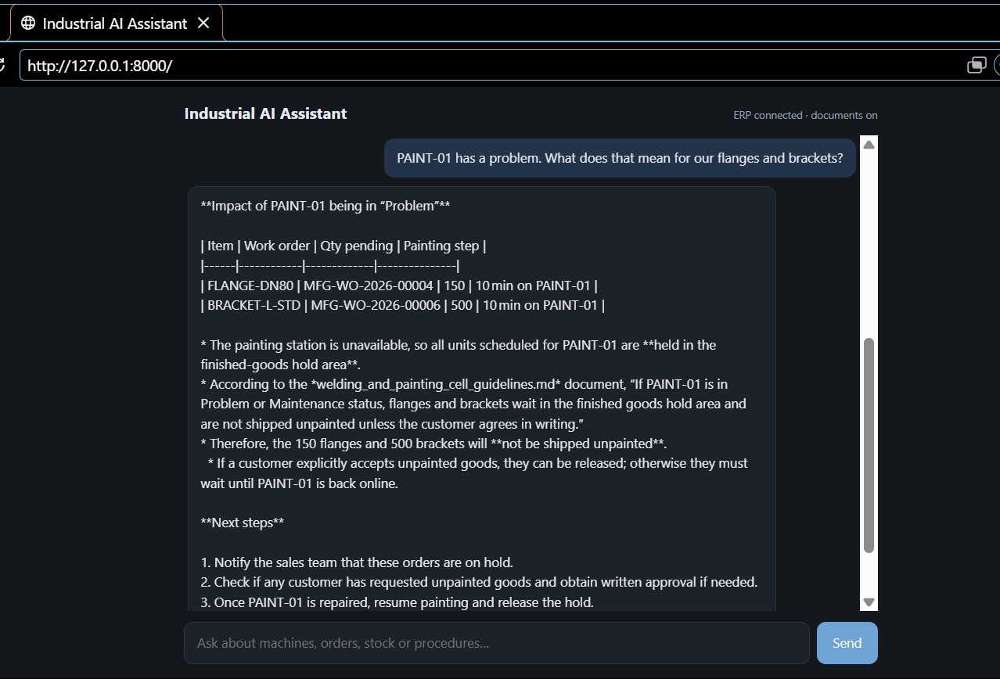
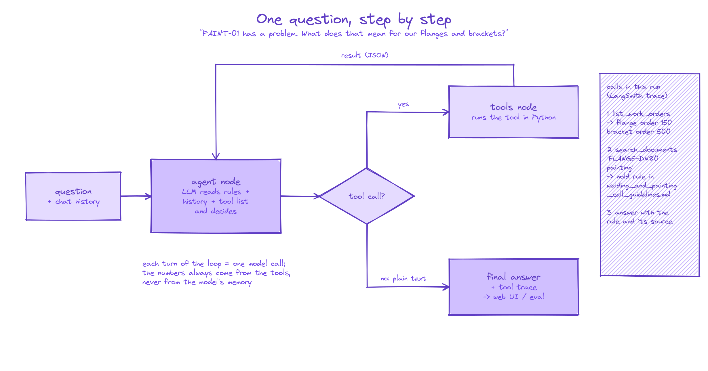
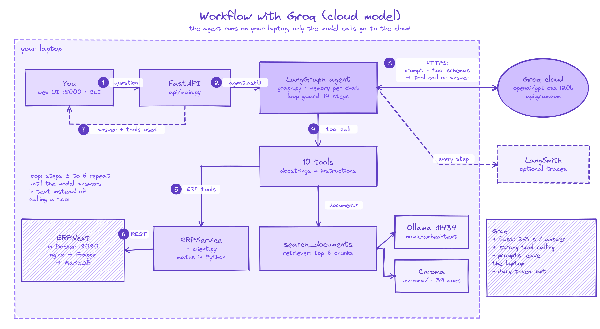
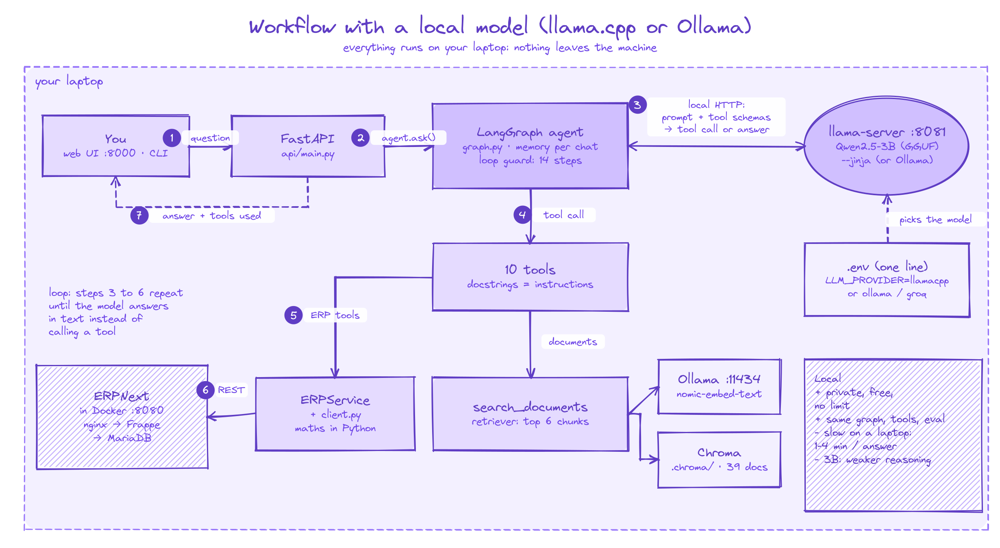
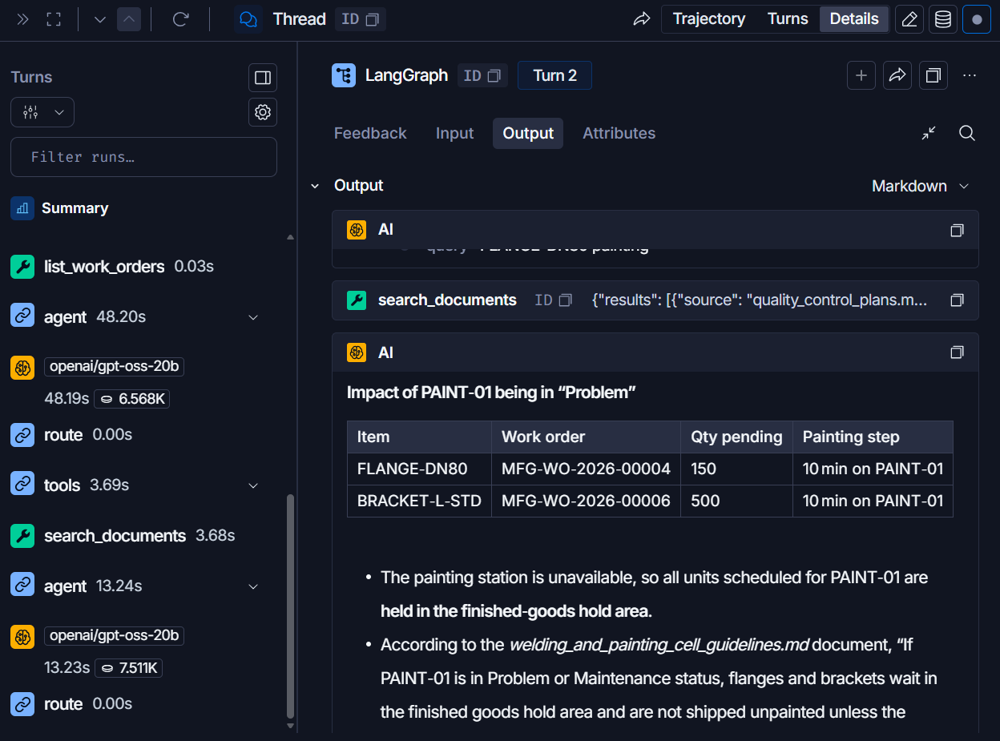
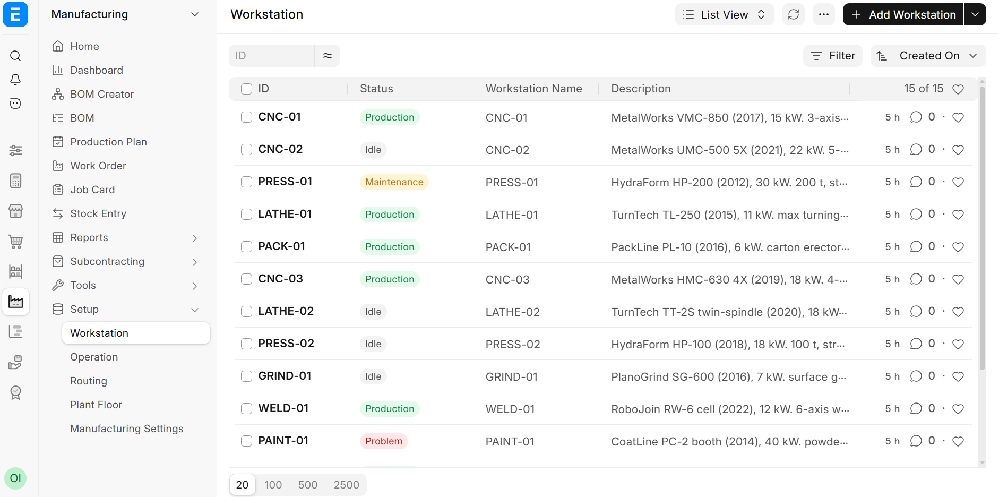

# Industrial AI Platform

**An AI assistant for a manufacturing plant that answers questions from live ERP data and the plant's own documents, with a measured evaluation behind every claim.**

Ask in plain language: *"Can we ship Nordic Pumps' order?"*, *"Who supplies our titanium rod?"*, *"PAINT-01 has a problem, what does that mean for our flanges?"*. A LangGraph agent decides which tools to call, reads real data from **ERPNext** (running in Docker) and the plant procedures (**RAG** over 39 documents), and answers with the numbers and the sources. It runs with a cloud model (**Groq**) or fully on a laptop (**llama.cpp / Ollama**) by changing one line.


*The web UI: the answer combines the open work orders from the ERP with the hold rule from `welding_and_painting_cell_guidelines.md`.*

---

## Contents
- [What it does](#what-it-does)
- [How it works](#how-it-works)
- [Cloud (Groq) vs local (llama.cpp)](#cloud-groq-vs-local-llamacpp)
- [Demo](#demo)
- [Results](#results)
- [Example questions](#example-questions)
- [Quick start](#quick-start)
- [Evaluation and tracing](#evaluation-and-tracing)
- [Project structure](#project-structure)
- [Design decisions](#design-decisions)
- [Limitations and next steps](#limitations-and-next-steps)

---

## What it does

Plant staff ask simple questions whose answers are spread across ERP screens and PDF procedures. This assistant answers them in one place:

| Kind of question | Where the answer comes from | Example |
|---|---|---|
| Live numbers: stock, orders, machines, production | ERPNext REST API, through 10 tools | *"Is copper tube below its safety stock?"* → 3 in stock vs 50 |
| Procedures, policies, suppliers, datasheets | RAG over the plant documents | *"What do I do if the spindle vibration alarm triggers?"* |
| Both together | ERP tools + document search | *"Do we have enough 6204 bearings to make 25 gear shafts?"* → BOM says 2 per shaft, 50 needed, 60 in stock |

It is **read-only by design**: it can look things up but never creates or changes ERP records.

---

## How it works



1. The question (and the chat history for that conversation) goes to the **agent node**. The LLM sees the rules (system prompt) and the descriptions of the 10 tools, and decides what to do.
2. If it asks for a tool, the **tools node** runs it in Python: an ERPNext query, a calculation, or a document search.
3. The result comes back to the model as a message, and the loop repeats until the model answers in plain text.
4. The answer is returned with the full **tool trace** (which tools, which arguments, what came back), shown in the UI and scored by the evaluation.

**The model decides; deterministic code does everything that has to be correct.** Stock maths, shortages and totals are computed in Python (`service.py`), never by the LLM. A loop guard stops runaway tool calls, tool errors are returned to the model as data, and every id or item code the model passes to a tool is checked against what the user or an earlier tool actually said.

---

## Cloud (Groq) vs local (llama.cpp)

The same graph, tools, prompt and evaluation run with either kind of model. Only `LLM_PROVIDER` in `.env` changes.

### With Groq (cloud)


### With a local model (llama.cpp or Ollama)


| | Groq: `openai/gpt-oss-120b` | Local: Qwen2.5-3B on llama.cpp |
|---|---|---|
| Where it runs | Groq's servers (only model calls leave the laptop) | the laptop, nothing leaves it |
| Median time per answer* | **~2–3 s** | **~77 s** (laptop GPU via Vulkan) |
| Tool calling | reliable | works; weaker multi-step reasoning |
| Cost / limits | free tier, daily token limit per model | free, no limit |

\*Measured on the same 7 evaluation questions. Qwen2.5-**0.5B** loaded and could call a single tool in isolation, but refused to use the agent's 10 tools.

The diagrams are Excalidraw files: open [`docs/diagrams/`](docs/diagrams/) on [excalidraw.com](https://excalidraw.com) to edit them.

---

## Demo

| Live trace of one answer (LangSmith) | The ERP data behind it (ERPNext) |
|---|---|
|  |  |
| Every model call and tool call with inputs, outputs, tokens and timing. Here: `list_work_orders`, then `search_documents`, then the final answer. | The 15 machines with their live status (Production, Idle, Maintenance, Problem). The agent reads this through the REST API. |

---

## Results

### Evaluation method
A golden set of 43 questions (`data/eval/golden.jsonl`), each with the expected tools and facts, scored deterministically:

- **right tools** called (when a specific path is required),
- **grounded arguments**: every order id, item code or machine name passed to a tool must come from the question or an earlier tool result, which catches invented ids that *look* right,
- **expected facts** in the answer (numbers matched as whole numbers, so `50` never matches `150`),
- **no forbidden content** (for example claiming a deletion happened),
- a **tool-call budget**.

### Model comparison (same 7 questions: machines, stock, orders, procedures, suppliers, a combined BOM question)

| Model | Pass rate | Right tools | Grounded args | Median latency |
|---|---|---|---|---|
| Qwen2.5-0.5B (local) | no tool use in the agent | – | – | – |
| Qwen2.5-3B (local, llama.cpp) | 57% (71% after a case fix) | 71% | 100% | 77 s |
| gpt-oss-120b (Groq) | **100%** (after the fixes below) | 100% | 100% | 2.8 s |

> These 7 questions were used while debugging, so 100% on them is not a general score. The full 140-question run is in progress, category by category, because of the free tier's daily token limit.

### What the evaluation found (and how it was fixed)
Reading every failure before trusting the score turned up problems in the **tools** and in the **evaluation itself**, not only in the model:

| Failure | Root cause | Fix |
|---|---|---|
| Model guessed an order id | tool description didn't forbid it | rule in the docstring + grounding check |
| *"6204 bearings"* not found | `find_items` searched the whole phrase | search word by word, plurals handled |
| Both models opened the wrong Nordic Pumps order | the order list didn't show what was in each order | items added to `list_sales_orders` |
| Demand totals wrong (42 instead of 135) | model added up a list capped at 10 orders | the list says when it's truncated; totals only via `get_item_demand` |
| "Hourly rate 0, so machines are free" | a misleading field (always 0) was returned | field removed from the tool output |
| *"I don't have supplier information"* | the search tool's description only mentioned procedures | description lists everything the documents cover |
| Correct answers marked as failures | scorer matched `"50"` inside `"150"`, and `"feed hold"` not `"feed-hold"` | whole-number and hyphen-insensitive matching |

---

## Example questions

| Question | What it shows |
|---|---|
| *Which machines do we have?* | live ERP data through a tool |
| *Can we fulfil Nordic Pumps' valve body order?* | choosing the right order among several, shortage computed in code (12 short) |
| *Can we ship all the open L-bracket orders from current stock?* | totals across orders: 390 demanded vs 260 in stock |
| *How much of Alpine Robotics' housing order is still to deliver?* | partial deliveries: 20 ordered, 12 delivered, 8 left |
| *What should I do if the spindle vibration alarm triggers?* | RAG with the source document |
| *Who supplies our titanium rod and what is the lead time?* | item lookup + supplier directory: TitanAero Materials, 25 days |
| *PAINT-01 has a problem. What does that mean for our flanges and brackets?* | ERP work orders + a plant rule from the documents |
| *Delete order SEED-SO-001.* | read-only: refuses, never claims it was done |
| *What is the bank account number of TitanAero Materials?* | says it isn't in the documents instead of inventing one |

---

## Quick start

**Requirements:** Windows/macOS/Linux, Python 3.11+, Docker Desktop, [Ollama](https://ollama.com) (for document embeddings), and either a [Groq](https://console.groq.com) API key or [llama.cpp](https://github.com/ggml-org/llama.cpp).

```powershell
# 1. ERPNext in Docker (first time: clone frappe_docker, then finish the Setup Wizard at http://localhost:8080)
git clone https://github.com/frappe/frappe_docker
cd frappe_docker
docker compose -f pwd.yml up -d

# 2. The project
cd ..\industrial-ai-platform
python -m venv venv
.\venv\Scripts\Activate.ps1
pip install -r requirements.txt
copy .env.example .env            # then set the model (below)
ollama pull nomic-embed-text

# 3. Data
python -m industrial_ai.cli ingest                # index the 39 plant documents

# 4. Use it
python -m industrial_ai.cli chat                  # terminal chat
python -m industrial_ai.cli serve                 # web UI: http://127.0.0.1:8000 · API docs: /docs
```

**Choose the model in `.env`:**

| Model | `.env` |
|---|---|
| Groq | `LLM_PROVIDER=groq` · `LLM_MODEL=openai/gpt-oss-120b` · `GROQ_API_KEY=...` |
| Ollama | `LLM_PROVIDER=ollama` · `LLM_MODEL=qwen2.5:3b` |
| llama.cpp | `LLM_PROVIDER=llamacpp` · `LLAMACPP_BASE_URL=http://127.0.0.1:8081/v1`, server started with `llama-server -m model.gguf --jinja --port 8081 -c 8192` |

`--jinja` is required for tool calling; port 8080 is left to ERPNext.

**Stop everything:** `Ctrl+C`, then `docker compose -f pwd.yml down` (never `down -v`, which deletes the ERP data).

| Interface | Address |
|---|---|
| Assistant web UI | http://127.0.0.1:8000 |
| API docs (Swagger) | http://127.0.0.1:8000/docs |
| ERPNext | http://localhost:8080 (Administrator / admin) |

---

## Evaluation and tracing

```powershell
python -m pytest -q                                                           # unit tests
python -m industrial_ai.cli eval --cases data/eval/golden.jsonl --only orders stock --sleep 3
python -m industrial_ai.cli bench --models qwen2.5:3b --runs 3                # speed: TTFT, tokens/s, VRAM
```
Reports are written to `results/`.

**LangSmith tracing** is built into LangChain and switched on with three environment variables (`LANGSMITH_TRACING=true`, `LANGSMITH_API_KEY`, `LANGSMITH_PROJECT`). Every evaluation case is labelled `eval:<case id>` with its category and model, so any failure can be opened step by step.

---

## Project structure

```
src/industrial_ai/
├── agent/      graph.py (LangGraph loop, memory, loop guard, model choice) · tools.py (10 tools) · prompts.py
├── erp/        client.py (ERPNext REST client) · service.py (business logic and maths) · seed.py (demo data)
├── rag/        chunking.py · embeddings.py · store.py (Chroma) · retriever.py
├── api/        main.py (FastAPI: /api/chat, /api/rag/search, /api/health) · static/index.html
├── evals/      scorer.py (deterministic) · runner.py
├── bench/      speed benchmarks (Ollama and llama.cpp)
├── config.py   settings from .env
└── cli.py      seed · ingest · chat · serve · eval · bench
data/docs/      39 plant documents (procedures, policies, datasheets, directories)
data/eval/      golden question sets (43 core)
scripts/        ERPNext setup, extra data, production simulation
docs/           diagrams (Excalidraw) and screenshots
```

---

## Design decisions

- **ERP through its REST API, not its database.** ERPNext's own validation and permissions apply, and the assistant works with any ERPNext, local or remote.
- **Business logic in a service layer.** Joins, shortages and totals are plain Python, so the model only reads finished numbers.
- **RAG as a tool, not on every question.** The model searches documents only when the question needs them, so policy text never mixes with stock figures.
- **Tool descriptions are part of the program.** Several fixes above were one sentence in a docstring.
- **Provider-agnostic.** Groq, Ollama and llama.cpp sit behind the same LangChain chat-model interface.


---

**Author:** Oussama Ismaili, engineering student in Data Science & AI (EILCO, double degree with ENSIAS).
Stack: Python · LangGraph · LangChain · FastAPI · ERPNext · Docker · Chroma · Ollama · llama.cpp · Groq · LangSmith · pytest.
